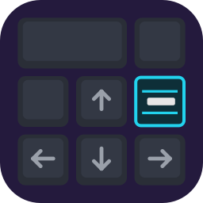
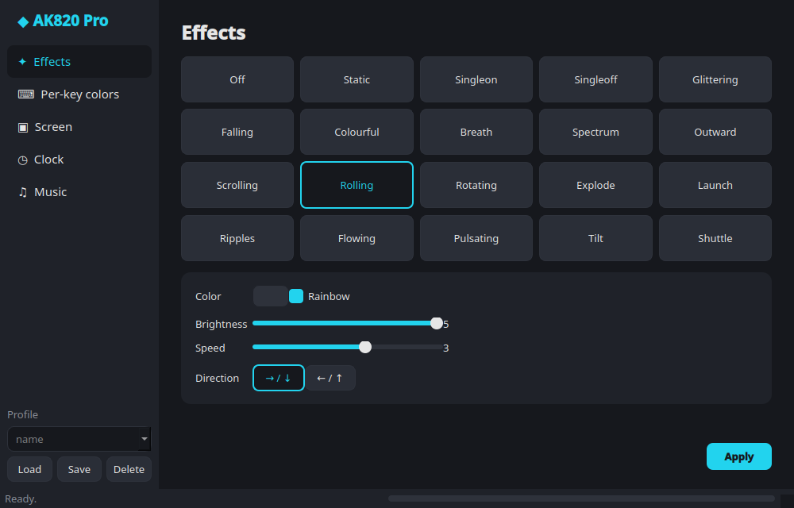
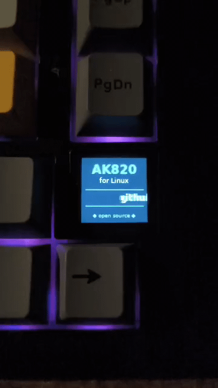
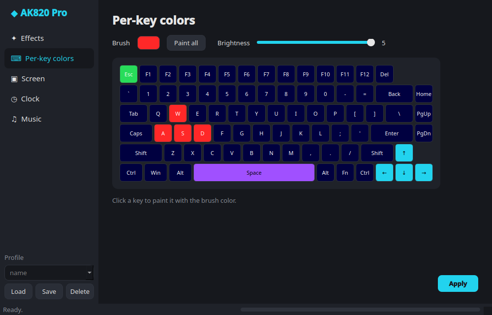
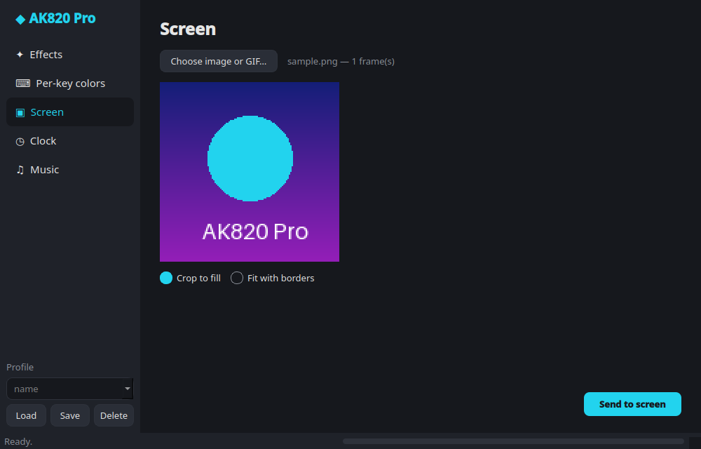
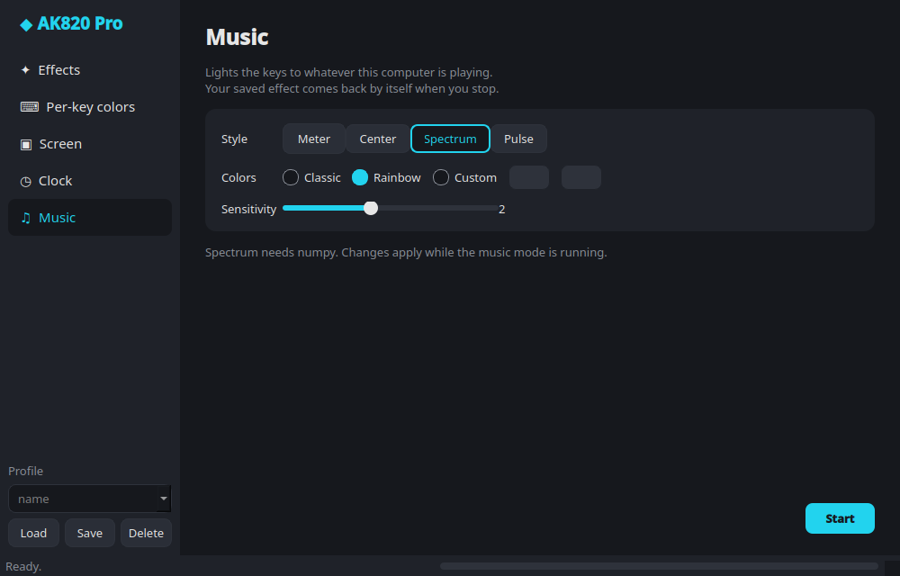

<div align="center">



# ak820-linux

**RGB lighting, screen GIFs and music mode for the AJAZZ AK820 Pro keyboard, on Linux.**<br>
No Windows, no vendor software: one download that runs on most distros.

[](https://github.com/hcristosm/ak820-linux/releases/latest)
[](LICENSE)




</div>

## Quick start

```sh
curl -LO https://github.com/hcristosm/ak820-linux/releases/latest/download/ak820-x86_64.AppImage
chmod +x ak820-x86_64.AppImage
./ak820-x86_64.AppImage
```

That's it: Python, Qt and everything else are inside the AppImage. The first time, it asks for your password
once so your user can open the keyboard (it installs a udev rule). Connect the keyboard with the USB cable;
the 2.4 GHz dongle and Bluetooth are not supported.

Runs on x86_64 distros with glibc 2.35 or newer: Ubuntu 22.04, Debian 12, Fedora 36, Linux Mint 21 and
anything newer. Want it in your app menu? [Gear Lever](https://flathub.org/apps/it.mijorus.gearlever) or
[AppImageLauncher](https://github.com/TheAssassin/AppImageLauncher) add it for you.

## Features

- **20 lighting effects** with color, rainbow, brightness, speed and direction
- **Per-key colors**: click keys to paint them
- **Screen**: send an image or animated GIF (up to 140 frames) to the 0.85" 128×128 display
- **Clock**: sync the screen clock to your PC
- **Music mode**: the keys react to whatever your PC is playing (level meter, center, spectrum or beat pulse)
- **Profiles** in the GUI, and a command line for scripts

| Per-key colors | Screen | Music |
|---|---|---|
|  |  |  |

Settings are remembered between runs, in `~/.config/ak820/config.json`. In **Profile** (bottom of the
sidebar), type a name and Save; Load fills in the pages and applies the profile's lighting (the screen image is
remembered but not re-sent, since uploads are slow); Delete asks first.

## Tested on

| Distro | How | Version |
|---|---|---|
| Linux Mint 22.3 (Cinnamon) | AppImage and `install.sh` | 0.3.2 |
| Fedora | `install.sh` | up to 0.3.1 |

Tried it on another distro? [Open an issue](https://github.com/hcristosm/ak820-linux/issues) and say whether it
worked, so this table can grow.

| Keyboard | USB ID | Status |
|---|---|---|
| AJAZZ AK820 Pro, wired USB | `0c45:8009` | effects, per-key colors, screen GIF and clock verified on the keyboard |
| AK820 variant | `0c45:800a` | listed by the vendor software, untested |

## Command line

The AppImage takes the same commands as `ak820` (`./ak820-x86_64.AppImage mode static -c 00ff88`).

```sh
ak820 mode static -c 00ff88 -b 5              # solid color, brightness 0-5
ak820 mode rolling -s 4 -d 1                  # no -c = rainbow; speed 0-5; direction 0/1
ak820 keys --all 101010 w=ff0000 a=ff0000 s=ff0000 d=ff0000
ak820 keys --list                             # key names
ak820 screen picture.gif                      # also png/jpg; --fit pad keeps the whole image
ak820 time                                    # sync the clock
ak820 music -g 1.5                            # react to the system audio until Ctrl-C; -g = sensitivity
ak820 music --style spectrum --colors rainbow # styles: meter center spectrum pulse
ak820 music --style pulse --colors ff0080-00ffff   # colors: classic, rainbow, or two colors
ak820 setup                                   # install the udev rule (only needed once)
ak820 --version
```

Effects: `off static singleon singleoff glittering falling colourful breath spectrum outward scrolling
rolling rotating explode launch ripples flowing pulsating tilt shuttle` (or their numbers 0-19).
Direction `0` = left→right / down, `1` = right→left / up. Rolling moves horizontally and scrolling vertically.

## Troubleshooting

- **`no permission to open /dev/hidraw…`**: run `ak820 setup` (`./ak820-x86_64.AppImage setup`), or accept
  the GUI's offer. Unplug and replug the keyboard if it still fails.
- **`AK820 interface … not found`**: use the USB cable (not the dongle or Bluetooth) and check that `lsusb`
  lists `0c45:8009`.
- **The AppImage doesn't start and mentions FUSE**: install your distro's `fuse3` package, or run it with
  `--appimage-extract-and-run`.
- **Music mode stays dark**: it needs `parec` (package `pulseaudio-utils`; works with PipeWire too) and
  something playing.
- **From source, the GUI quits with `Could not load the Qt platform plugin "xcb"`**: install `libxcb-cursor0`
  (Debian/Ubuntu) or `xcb-util-cursor` (Fedora/Arch). The AppImage already has it.

## Install from source

For a native install with a menu entry, or to hack on the code. Needs Python 3 with PySide6 (Qt 6) and Pillow:

<details>
<summary>Dependencies per distro</summary>

```sh
sudo dnf install python3-pyside6 python3-pillow                 # Fedora
sudo apt install python3-pyside6.qtwidgets python3-pil          # Debian 13+ / Ubuntu 24.10+
sudo apt install python3-pip python3-pil libxcb-cursor0         # Ubuntu 24.04 / Linux Mint 22 (no PySide6 package),
pip install --user --break-system-packages PySide6              #   then PySide6 from pip
pip install --user PySide6 pillow                               # anything else
```

A PySide6 from pip (Qt 6.5+) needs `libxcb-cursor0` (Debian/Ubuntu) or `xcb-util-cursor` (Fedora/Arch) to open
its window on X11. Ubuntu 24.04 refuses `pip install` outside a virtualenv unless you pass
`--break-system-packages`; with `--user` it only writes to `~/.local`, not to the system's Python.

Music mode also needs `parec` (package `pulseaudio-utils`), and its spectrum style needs numpy (`python3-numpy`).

</details>

```sh
git clone https://github.com/hcristosm/ak820-linux
cd ak820-linux
./install.sh
```

`install.sh` copies the program to `~/.local/share/ak820`, adds `ak820` and `ak820-gui` to `~/.local/bin`,
creates an "AJAZZ AK820 Pro" entry in the app menu, and installs the udev rule (asks for your password once).
`./install.sh --uninstall` removes everything. You can also run `./ak820.py` or `./ak820_gui.py` straight from
the cloned folder.

Self-checks that need no keyboard: `ak820 selftest` (packet builders) and `ak820-gui selftest` (settings and
profiles survive a restart). Build the AppImage yourself with `./appimage/build.sh`. Prefer a lighter GUI without
Qt? The Tkinter version lives on the [`tk-gui`](https://github.com/hcristosm/ak820-linux/tree/tk-gui) branch.

## How it works

The USB protocol was recovered by reverse engineering the vendor's Windows configurator; it is written up in
[docs/PROTOCOL.md](docs/PROTOCOL.md). Not implemented: key remapping, macros, and wireless (2.4 GHz) mode.
Music styles are this project's own, not the vendor's.

## License

MIT. Unofficial project, not affiliated with or endorsed by AJAZZ.
